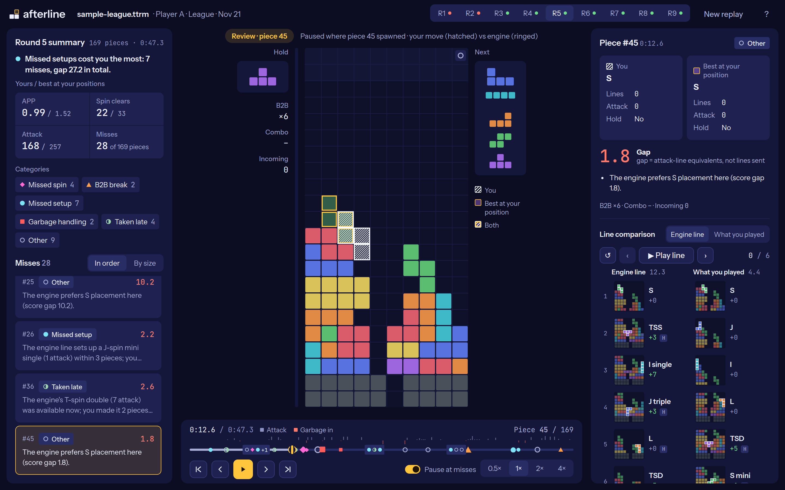
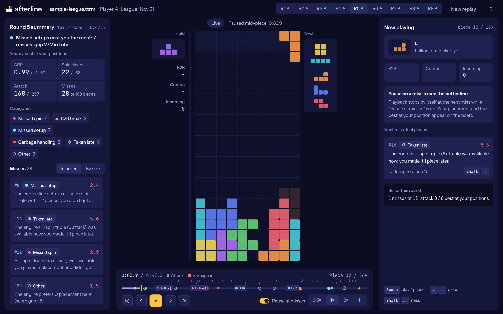
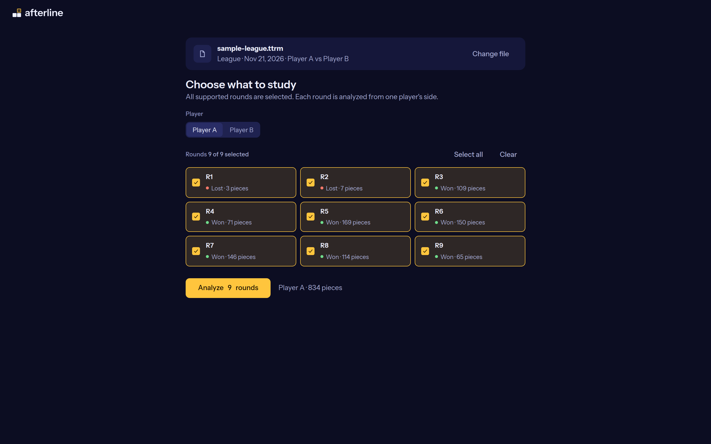
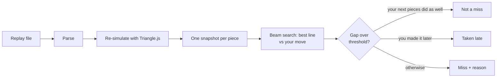

<p align="center">
  <picture>
    <source media="(prefers-color-scheme: dark)" srcset="apps/web/public/logos/afterline-wordmark.svg">
    
  </picture>
</p>

<p align="center">
  <strong>See the moves you missed.</strong><br>
  Drop a TETR.IO replay. Afterline replays your game frame by frame and shows every spin, setup and
  B2B chain you left on the board, next to the line that would have worked.
</p>

<p align="center">
  <a href="LICENSE"></a>
  
  
  
  
</p>

<p align="center">
  
</p>

## What you get

- **Your actual game, played back.** Not snapshots: the real replay re-simulated with
  [Triangle.js](https://github.com/halp1/triangle), at 0.5× to 4×, with every miss marked on the timeline.
- **Both moves on one board.** Where you put the piece (hatched) and the best move at your position
  (ringed), with the reason in plain words and how much it cost.
- **The line, not just the move.** Step through the engine's next six pieces next to what you actually
  played, so you can see where the attack went.
- **Misses that are fair.** If your plan paid off, it isn't a miss. If you took the spin a piece later, it's
  labelled *Taken late*, not *Missed*.
- **A verdict per round.** The habit that cost you most, your APP against the best at your positions, and
  every miss by category: missed spin, B2B break, missed setup, garbage handling, taken late.

<table>
  <tr>
    <td width="50%"></td>
    <td width="50%"></td>
  </tr>
  <tr>
    <td align="center"><sub>Live playback stops at each miss</sub></td>
    <td align="center"><sub>Pick a player and rounds</sub></td>
  </tr>
</table>

## Quick start

You need [Bun](https://bun.sh) and Node.js (tested with Node 24).

```bash
git clone https://github.com/ddnzcn/afterline.git
cd afterline
bun install
bun run dev
```

Open <http://localhost:5173> and drop a replay. League (`.ttrm`) and 40L (`.ttr`) replays work; Blitz and
Quick Play aren't supported yet. Export a replay from TETR.IO's replay menu.

<details>
<summary><strong>Keyboard</strong></summary>

| Key | Action |
| --- | --- |
| <kbd>Space</kbd> | Play / pause |
| <kbd>←</kbd> <kbd>→</kbd> | Previous / next piece |
| <kbd>Shift</kbd> + <kbd>←</kbd> <kbd>→</kbd> | Previous / next miss |
| <kbd>↑</kbd> <kbd>↓</kbd> | Step through the line |
| <kbd>L</kbd> | Play the line |
| <kbd>E</kbd> | Engine line / what you played |
| <kbd>Esc</kbd> | Reset the line |
| <kbd>Home</kbd> <kbd>End</kbd> | Start / last piece |
| <kbd>?</kbd> | Show these keys |

</details>

<details>
<summary><strong>Command line</strong></summary>

```bash
bun run analyze game.ttrm --player you --round 3 --insights
```

| Flag | Does |
| --- | --- |
| `-p, --player <name>` | Whose game to analyze (needed for league replays) |
| `-r, --round <n>` | 1-based round, repeatable (default: all) |
| `-i, --insights` | Run the engine and print each round's summary and biggest misses |
| `-w, --weights <file>` | JSON overrides for the eval weights (see below) |
| `-o, --out <file>` | Write the JSON here instead of stdout |

The API's worker pool uses one process per CPU core minus one. Set `ANALYSIS_WORKERS=4` to cap it on
machines with less memory.

</details>

## How it works



Every placement is compared with the best move at your position, six pieces deep. TETR.IO's rules come
from Triangle.js, never reimplemented, and the analysis was checked against TETR.IO's own end-of-game
stats: league replays match exactly on pieces, lines, holds, attack and every clear type.

The full story, from the move generator to the accuracy checks, is in
[docs/how-it-works.md](docs/how-it-works.md).

## Tuning the engine

Every weight lives in [`packages/core/src/search/weights.ts`](packages/core/src/search/weights.ts).
Scores are in attack-line equivalents: one line of attack is worth 1.0, so every other weight reads
relative to that.

| Group | Weights | What they do |
| --- | --- | --- |
| move | `attack`, `cancel` | Per line of attack sent / incoming line cancelled |
| move | `b2bKeep`, `b2bBreakFlat`, `b2bBreakPerLevel` | Keeping B2B, and the cost of breaking it |
| move | `combo`, `wastedClear`, `tanked`, `perfectClear` | Combo steps, clears that send nothing, garbage taken, PCs |
| board | `holes`, `coveredHoleDepth` | Covered empty cells and how buried they are |
| board | `maxHeight`, `danger`, `dangerHeight` | Stack height, with a steep cost above `dangerHeight` |
| board | `bumpiness`, `extraWells` | Surface roughness and extra deep wells |
| board | `tSlotBase`, `tSlotLine`, `readyLines`, `heldT` | T-slots, near-complete rows, a T in hold |
| board | `b2bChain` | Value of a held B2B chain (stored surge); 0 makes the engine cash out early |
| search | `depth`, `width`, `topN`, `discount` | Look-ahead, beam width, alternatives, discount per step |
| insights | `missThreshold`, `setupHorizon`, `topMisses` | When a move counts as a miss, setup window, summary length |

Try a change without editing the file and compare the summaries:

```bash
echo '{ "board": { "tSlotLine": 1.4 }, "insights": { "missThreshold": 2 } }' > spin-heavy.json
bun run analyze game.ttrm -p you -r 3 --insights -w spin-heavy.json > /dev/null
```

## Project layout

| Path | What's there |
| --- | --- |
| [`packages/core`](packages/core) | Pure TypeScript: replay parsing, re-simulation, move generation, search, insights |
| [`apps/api`](apps/api) | Fastify server with a worker pool that runs the analysis |
| [`apps/web`](apps/web) | React + Vite app with the canvas board and replay player |
| [`apps/cli`](apps/cli) | `bun run analyze` for the terminal |

```bash
bun run test        # 125 tests across core, api and web
bun run typecheck
```

The replay accuracy tests run against your own replays: put `.ttrm` / `.ttr` files in `fixtures/replays/`
(git-ignored, since replays contain user ids).

## License

[MIT](LICENSE). The bundled fonts, Instrument Sans and JetBrains Mono, are under the SIL Open Font
License 1.1 ([`apps/web/public/fonts/LICENSE.md`](apps/web/public/fonts/LICENSE.md)). Replay
re-simulation uses [Triangle.js](https://github.com/halp1/triangle) (`@haelp/teto`, MIT).

Afterline is a fan-made tool and isn't affiliated with TETR.IO.
